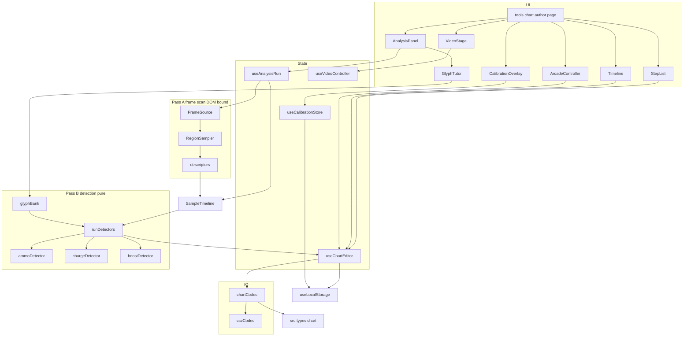
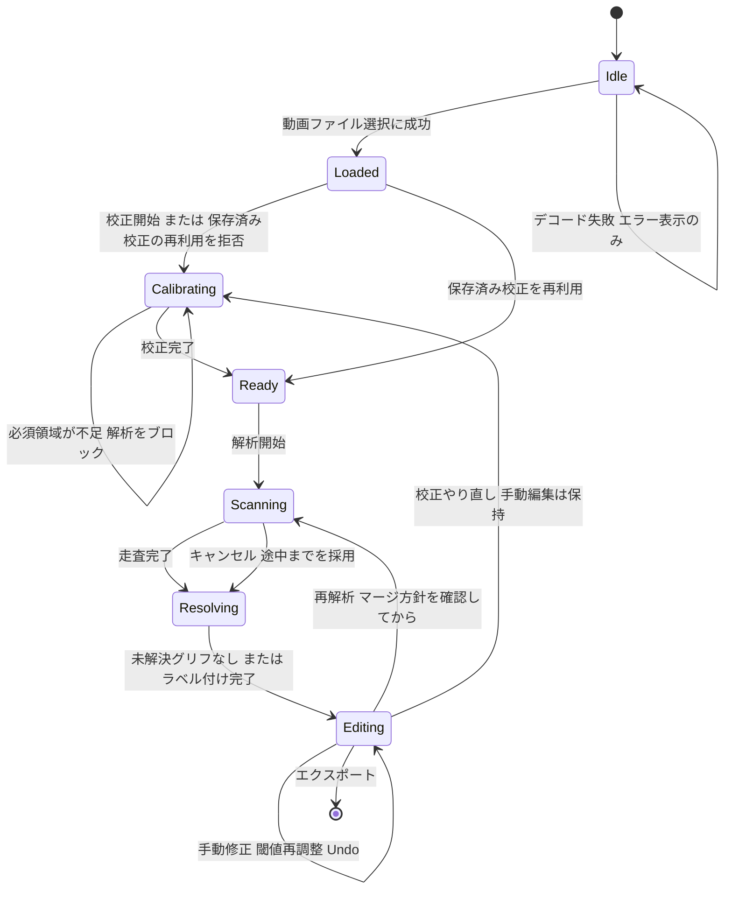
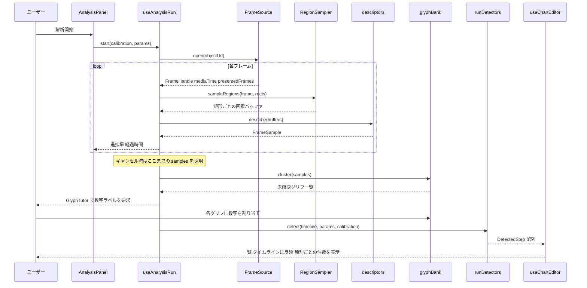
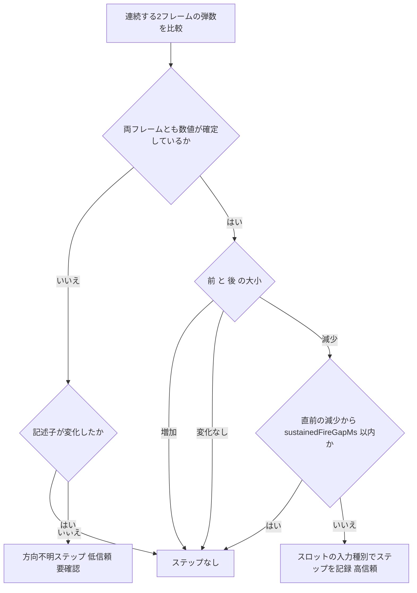
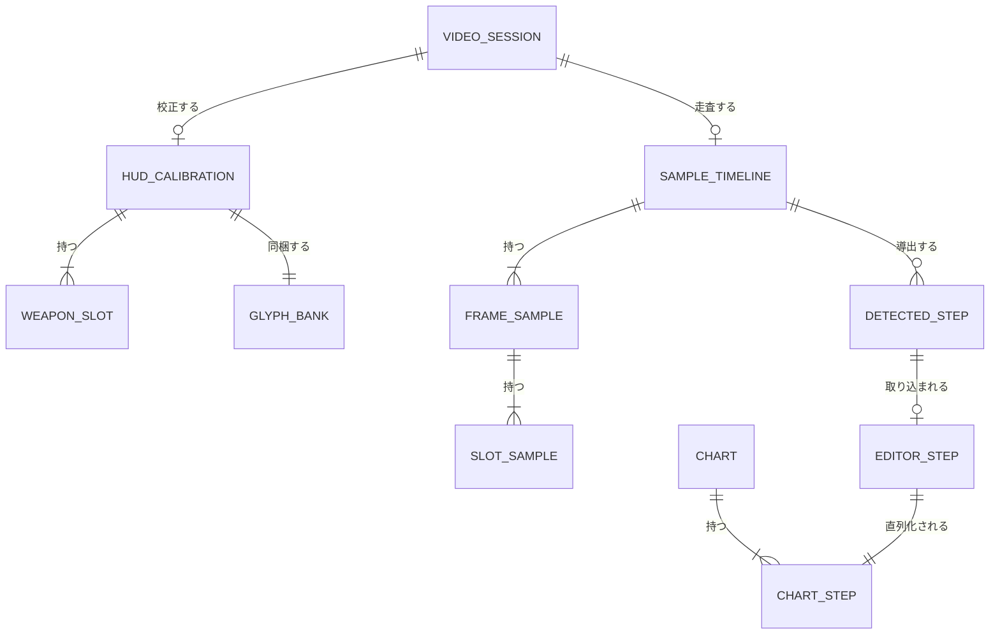

# 技術設計書: chart-authoring-tool

## Overview

譜面作成ツールは、アーケード版 EXVS2 OB/XB のプレイ動画（画面録画ファイル）から「何分何秒にどの入力があったか」を抽出し、人が確認・修正したうえで共通フォーマットの譜面 JSON として書き出す、ブラウザ内完結のツールである。HUD の弾数表示・CHARGE 表示・ブーストゲージという 3 つの視覚的な手がかりを時系列で追い、そこから入力イベントを導出する。

**Users**: 譜面作成者（本プロジェクトの開発者）が PC ブラウザで利用する。一般ユーザー導線からは到達できない専用ルートに置く。

**Impact**: 既存アプリに初めて映像処理を持ち込む。既存の練習体験には影響を与えず、ルートレイアウトへの変更はアナリティクス除外のための最小限に留める。譜面型（`Chart` / `ChartStep` / `ChartSource`）を `src/types` に新設し、後続の練習モードスペックと共有する。

> 本設計におけるパス表記はすべて Next アプリのルート `next/` を基準とする（例: `src/features/chart-author/` は `next/src/features/chart-author/`）。

### Goals

- 動画ファイルをローカルに保持したまま、HUD の変化から射撃系・チャージ・ブースト候補の入力タイミングを自動抽出する
- 自動抽出結果を、コマ送り再生・タイムライン・一覧の 3 つのビューで人が検証し、追加・削除・時刻調整・種別変更できるようにする
- 後続スペックが読み込める、バージョン付き譜面 JSON の契約を確定させる
- 検出ロジックを DOM 非依存の純関数として切り出し、jsdom 上で単体テスト可能にする
- 閾値の再調整とグリフラベルの後付けを、動画の再走査なしに行えるようにする

### Non-Goals

- YouTube などの外部サービスからの動画取得
- 格闘入力（`melee`）の自動検出
- 譜面を使った練習モード本体（別スペック `chart-practice`）
- WebCodecs / Web Worker によるデコードの高速化（`FrameSource` の追加実装として将来に残す）
- 家庭用 MBON など、アーケード版以外の HUD レイアウトへの対応
- スマートフォンでの利用と横画面ガードの適用
- 動画・譜面のサーバー保存

---

## Boundary Commitments

### This Spec Owns

- 譜面フォーマットの契約（`Chart` / `ChartStep` / `ChartSource` の形と `version` の意味）と、その検証・直列化ロジック
- 動画フレームから HUD 領域の観測値を取り出す層（`FrameSource` / `RegionSampler` / 記述子化）
- 観測値の中間表現 `SampleTimeline` と、そこから入力ステップを導出する検出器群
- HUD 校正データ（`HudCalibration`）の形と、その localStorage 永続
- 譜面編集の状態機械（追加・削除・時刻調整・種別変更・全体オフセット・Undo）
- ツール専用ルート `/tools/chart-author` の UI 一式

### Out of Boundary

- 譜面の再生・判定・スコアリング（`chart-practice` スペックが所有）
- `ArcadeController` の入力検出ロジック（`arcade-controller` フィーチャーが所有。本スペックは無改変で利用する）
- アナリティクスの収集・送信ロジック（`analytics` フィーチャーが所有。本スペックは「除外パス」という 1 つの設定点のみを追加する）
- `ConfirmDialog` / `CapsuleButton` の仕様変更（既存のまま使う。合わない場合はフィーチャー内に専用実装を置く）
- 動画ファイルの変換・トランスコード（ユーザーが事前に行う前提）

### Allowed Dependencies

- `src/types`（`ButtonType` / `isButtonType` / `StorageResult`）— 譜面型もここに追加する
- `src/hooks/useLocalStorage` — 校正と作業中譜面の永続化
- `src/components/CapsuleButton` — 操作ボタン
- `src/styles/theme.css` のトークン — 配色・グロー・タイポグラフィ
- **例外**: `src/features/arcade-controller/ArcadeController` — steering の「フィーチャー間 import 禁止」に対する明示的な例外。Req 9.4 が無改変での再利用を要求しているため、本設計はこの 1 コンポーネントに限って依存を許可する。これ以外のフィーチャーへの依存は禁止のまま維持する。
- `src/features/analytics/excludedPaths`（新設）— 本フィーチャーからは import しない。`analytics` 側が参照する設定点であり、依存方向は `analytics` → 設定、で閉じる。

### Revalidation Triggers

- `Chart` / `ChartStep` / `ChartSource` の形が変わる、または `CHART_FORMAT_VERSION` が上がる → `chart-practice` スペックの読み込み側が再検証を要する
- `ButtonType` に値が追加・削除される → 譜面の検証と種別選択 UI の両方が影響を受ける
- `ArcadeController` の `onButtonPress` シグネチャが変わる → 手動ラベル付けの導線が壊れる
- `useLocalStorage` の `StorageResult` 形が変わる → 校正・作業中譜面の永続化が影響を受ける
- ルートレイアウトのグローバル要素（GA スクリプト / トラッカー）の構成が変わる → Req 9.3 の除外が破れる可能性がある

---

## Architecture

### Existing Architecture Analysis

本アプリはフィーチャーファーストの Next.js App Router 構成で、状態はすべてクライアント側（localStorage）に閉じている。以下の制約を前提とする。

- `globals.css` が `html, body { height: 100%; overflow: hidden }` を敷いているため、縦に長い UI を持つページは自前のスクロールコンテナを用意する必要がある
- `LandscapeGuard` は各ページが明示的に包む方式のため、包まなければ Req 9.2（横画面ガード非適用）は自動的に満たされる
- ルートレイアウトが `HamburgerMenu`・`BackToHomeNav`・`AnalyticsPageViewTracker`・GA スクリプトを全ページに適用する。前二者は許容し、後二者は除外パス機構で無効化する
- jsdom は canvas を実装しないため、`drawImage` / `getImageData` に依存するコードは単体テストできない。検出ロジックは DOM 非依存の純関数として切り出すことが必須である
- 既存コードベースに映像処理・Worker・canvas の利用実績はなく、映像系の npm 依存も存在しない。本設計は追加依存ゼロで構成する

### Architecture Pattern & Boundary Map

**選定パターン**: 2 パスのパイプライン + ポート／アダプタ。重い「フレーム走査」と軽い「検出」を中間表現 `SampleTimeline` で分断し、フレーム供給を `FrameSource` インターフェースの背後に隠す。



**Architecture Integration**:

- **依存方向（左が下位、右は左へのみ依存できる）**:
  `src/types` → `chart-author/types` → `chart-author/analysis` → `chart-author/frame-source` → `chart-author/{editor,io}` → UI コンポーネント → ページ
  `analysis` は DOM API を一切参照しない。`frame-source` のみが `HTMLVideoElement` / `CanvasRenderingContext2D` に触れる。この 1 本の線が、jsdom 上でのテスト可能性を担保する唯一の仕組みである。
- **境界の分離**: 「観測（何が映っていたか）」と「解釈（それが何の入力か）」を `SampleTimeline` で切る。観測は 1 回・不可逆（動画の再走査が必要）、解釈は何度でも・即時。Req 4.5 の閾値調整と、グリフラベルの後付け解決は、この分断があって初めて成立する。
- **既存パターンの踏襲**: reducer による状態管理（`usePracticeSession` の流儀）、`useLocalStorage` + `StorageResult` による永続化、`isButtonType` による境界での検証（`useCommandStore` の流儀）、CSS Modules + テーマトークン。
- **新規コンポーネントの必要理由**: `FrameSource` は供給方式の差し替え余地（rVFC / シーク / 将来の WebCodecs）を確保するため。`SampleTimeline` は再走査回避とテスト可能性のため。`GlyphTutor` は弾数の方向判定という最大リスクを、追加依存なしで人の手に安全に逃がすため。
- **Steering 準拠**: TypeScript strict・`any` 不使用・フィーチャーファースト・命名規約（コンポーネント PascalCase / フック camelCase / ディレクトリ kebab-case）を維持する。フィーチャー間 import 禁止に対しては `ArcadeController` のみを明示的な例外として記録する。

### Technology Stack

| Layer | Choice / Version | Role in Feature | Notes |
|-------|------------------|-----------------|-------|
| Frontend | Next.js 16.2.4 App Router / React 19.2.4 | 専用ルート `/tools/chart-author` とクライアントコンポーネント群 | 既存スタックのまま。追加依存なし |
| 言語 | TypeScript 5 (strict) | 全レイヤ | `any` 禁止。境界は判別可能ユニオンで表現する |
| 映像デコード | `HTMLVideoElement` + `requestVideoFrameCallback` | Pass A のフレーム供給（既定） | Chrome 83+ / Safari 15.4+ / Firefox 132+。非対応時はシーク方式へフォールバック |
| 画素取得 | `HTMLCanvasElement` 2D context（`willReadFrequently: true`） | 校正矩形内のみを `getImageData` で取得 | 全画面ではなく矩形単位に限定して負荷を抑える |
| スタイル | CSS Modules + `src/styles/theme.css` | 既存トークンで配色・グローを統一 | タイムラインの色は `--color-accent-primary` / `--color-warning` / `--color-success` を割り当てる |
| データ / ストレージ | `localStorage`（`useLocalStorage` 経由） | 校正（Req 2.6）と作業中譜面（Req 8.8）のみ | `SampleTimeline` はメモリ専用。クォータを圧迫させない |
| テスト | Vitest 3 + jsdom 29 + Testing Library | 純関数の単体テストと UI の結合テスト | `analysis` / `io` / `editor` が主対象。`frame-source` はフェイク実装で差し替える |

WebCodecs + デマクサ（`mp4box.js` / `web-demuxer`）を採らなかった理由は `research.md` の「フレーム供給方式の選定」に記録している。

---

## File Structure Plan

### Directory Structure

```
src/
├── types/
│   ├── chart.ts                       # 譜面フォーマットの共有型と検証（後続スペックと共有）
│   └── index.ts                       # chart.ts を再エクスポート（変更）
├── app/
│   └── tools/
│       └── chart-author/
│           └── page.tsx               # サーバーコンポーネント。ChartAuthorApp を描画するだけ
└── features/
    ├── analytics/
    │   ├── excludedPaths.ts           # 計測除外パスの単一定義（新設）
    │   ├── GoogleAnalyticsScripts.tsx # GA の Script を保持するクライアント component（新設）
    │   └── AnalyticsPageViewTracker.tsx  # 除外判定を追加（変更）
    └── chart-author/
        ├── ChartAuthorApp.tsx         # 全体の組み立てとワークフロー状態機械
        ├── types.ts                   # ツール内部型（Rect / HudCalibration / SampleTimeline 等）
        ├── constants.ts               # FRAME_DURATION_MS / 既定 AnalysisParams / storage key
        ├── analysis/                  # DOM 非依存の純関数のみ
        │   ├── descriptors.ts         # ImageData 相当 → グリフ記述子 / 輝度統計 / 充填率
        │   ├── glyphBank.ts           # 記述子のクラスタリングと数字ラベル解決
        │   ├── ammoDetector.ts        # 弾数推移 → 射撃系ステップ
        │   ├── chargeDetector.ts      # CHARGE 点灯推移 → チャージ開始/終了ステップ
        │   ├── boostDetector.ts       # ブースト充填率 → bd 候補ステップ
        │   └── runDetectors.ts        # Pass B のオーケストレーション
        ├── frame-source/              # DOM に触れる唯一の層
        │   ├── types.ts               # FrameSource / FrameHandle の契約
        │   ├── playbackFrameSource.ts # rVFC + playbackRate（既定）
        │   ├── seekingFrameSource.ts  # currentTime + seeked（フォールバック）
        │   ├── createFrameSource.ts   # 能力検出で実装を選ぶファクトリ
        │   └── regionSampler.ts       # video → canvas → 矩形ごとの画素バッファ
        ├── calibration/
        │   ├── CalibrationOverlay.tsx # 動画上での矩形ドラッグ描画
        │   ├── SlotInspector.tsx      # スロットの種別・桁数・CHARGE 設定
        │   ├── slotClassifier.ts      # ボタン表示（3つ丸）→ 入力種別の推定（純関数）
        │   └── useCalibrationStore.ts # 校正の localStorage 永続と videoKey 照合
        ├── player/
        │   ├── VideoStage.tsx         # 閲覧用 video と校正オーバーレイの土台
        │   ├── TransportBar.tsx       # 再生/一時停止/コマ送り/時刻表示
        │   └── useVideoController.ts  # 再生・シーク・コマ送りの制御
        ├── analysis-run/
        │   ├── useAnalysisRun.ts      # Pass A 実行・進捗・キャンセル・再解析マージ
        │   ├── AnalysisPanel.tsx      # 進捗・パラメータ・集計表示
        │   ├── GlyphTutor.tsx         # 未解決グリフへの数字ラベル付け
        │   └── RerunDecisionDialog.tsx# Req 5.4 の 3 択ダイアログ
        ├── editor/
        │   ├── chartReducer.ts        # 編集アクションと逆操作（純関数）
        │   ├── useChartEditor.ts      # reducer + Undo スタック + 自動保存
        │   ├── StepList.tsx           # 時刻順一覧とフィルタ
        │   ├── StepInspector.tsx      # 選択ステップの種別変更・時刻微調整・削除
        │   └── Timeline.tsx           # 尺に対応したマーカー表示
        └── io/
            ├── chartCodec.ts          # 譜面 JSON の生成と検証（純関数）
            ├── csvCodec.ts            # CSV 生成（純関数）
            └── useChartIo.ts          # ダウンロードとファイル読み込み
```

各フィーチャー内コンポーネントは同名の `*.module.css` を伴う（既存の慣習どおり。個別列挙は省略）。

### Modified Files

- `src/types/index.ts` — `export * from './chart'` を追加。既存の型定義は変更しない
- `src/features/analytics/AnalyticsPageViewTracker.tsx` — `isAnalyticsExcludedPath(pathname)` が真なら `trackPageView` を呼ばない（Req 9.3）
- `src/app/layout.tsx` — GA の 2 つの `<Script>` を `<GoogleAnalyticsScripts />` に置き換える。描画内容は除外パス以外で従来と同一

---

## System Flows

### ワークフロー状態機械



校正やり直し（Req 2.7）と再解析（Req 5.4）はいずれも手動編集を失わせない。再解析は必ず `RerunDecisionDialog` を経由し、ユーザーが「自動検出のみ差し替え」か「全ステップ破棄」かを選ぶまで進まない。

### 2 パス解析のシーケンス



閾値を変えた場合（Req 4.5）は `runDetectors` のみを再実行する。グリフラベルを後から追加した場合も同様で、`FrameSource` は再び開かれない。

### 弾数変化からステップを導く判定



増加（リロード）を記録しない規則（Req 3.3）と、連射を 1 ステップに畳む規則（Req 3.4）はこの判定に集約される。数値が確定していない間は Req 3.3 を厳密には保証できないため、方向不明ステップとして人の確認に委ねる。

---

## Requirements Traceability

| Requirement | Summary | Components | Interfaces | Flows |
|-------------|---------|------------|------------|-------|
| 1.1 | ローカル動画を読み込み尺と解像度を表示 | ChartAuthorApp, useVideoController | `loadVideoFile` | ワークフロー状態機械 |
| 1.2 | 動画をサーバーへ送信しない | ChartAuthorApp | — | — |
| 1.3 | デコード不可時はファイル名付きエラーと状態保持 | useVideoController | `VideoLoadResult` | ワークフロー状態機械 |
| 1.4 | ms 単位の再生・一時停止・シーク | useVideoController, TransportBar | `VideoController` | — |
| 1.5 | 1/30 秒のコマ送り | useVideoController, TransportBar | `stepFrame` | — |
| 1.6 | `mm:ss.mmm` の時刻表示 | TransportBar | `formatTimecode` | — |
| 2.1 | 解析前に校正ステップへ入る | ChartAuthorApp | `WorkflowPhase` | ワークフロー状態機械 |
| 2.2 | 5 スロット・CHARGE・ブーストの矩形指定 | CalibrationOverlay | `HudCalibration` | — |
| 2.3 | ボタン表示から入力種別を推定し提示 | slotClassifier, SlotInspector | `classifySlotInputType` | — |
| 2.4 | 推定種別の上書き | SlotInspector | `WeaponSlotCalibration` | — |
| 2.5 | 必須領域不足時は解析をブロックし不足を提示 | useCalibrationStore | `validateCalibration` | ワークフロー状態機械 |
| 2.6 | 校正をファイル名キーで永続化し再利用を提案 | useCalibrationStore | `VideoKey` | — |
| 2.7 | 解析後も校正をやり直せ、手動編集を失わない | ChartAuthorApp, useChartEditor | `WorkflowPhase` | ワークフロー状態機械 |
| 3.1 | 校正領域のみを 30fps 以上で走査 | useAnalysisRun, FrameSource, RegionSampler | `FrameSource` | 2 パス解析 |
| 3.2 | 弾数減少で該当種別のステップを記録 | ammoDetector | `detectAmmoSteps` | 弾数判定 |
| 3.3 | 弾数増加では記録しない | ammoDetector | `detectAmmoSteps` | 弾数判定 |
| 3.4 | 連続減少は開始 1 点に畳む | ammoDetector | `AnalysisParams.sustainedFireGapMs` | 弾数判定 |
| 3.5 | 全ステップに 0〜1 の confidence | runDetectors | `DetectedStep` | 2 パス解析 |
| 3.6 | CHARGE 消灯→点灯で charge-start | chargeDetector | `detectChargeSteps` | — |
| 3.7 | CHARGE 点灯→消灯で charge-end | chargeDetector | `detectChargeSteps` | — |
| 3.8 | 格闘は自動検出しない | runDetectors | — | — |
| 4.1 | 閾値超のブースト急減で `bd` を記録 | boostDetector | `detectBoostSteps` | — |
| 4.2 | 緩やかな減少は記録しない | boostDetector | `AnalysisParams.boostDropWindowMs` | — |
| 4.3 | ゲージ増加では記録しない | boostDetector | `detectBoostSteps` | — |
| 4.4 | ブースト由来は低信頼かつ候補表示 | boostDetector, StepList, Timeline | `CONFIDENCE` | — |
| 4.5 | 急減閾値を調整可能なパラメータとして公開 | AnalysisPanel, runDetectors | `AnalysisParams` | 2 パス解析 |
| 5.1 | 進捗率と経過時間の表示 | useAnalysisRun, AnalysisPanel | `AnalysisProgress` | 2 パス解析 |
| 5.2 | キャンセル可能・途中結果を保持 | useAnalysisRun | `cancel` | 2 パス解析 |
| 5.3 | 完了時に種別ごとの件数を表示 | AnalysisPanel | `DetectionSummary` | 2 パス解析 |
| 5.4 | 再解析時のマージ方針を確認・手動分を消さない | RerunDecisionDialog, useChartEditor | `RerunStrategy` | ワークフロー状態機械 |
| 5.5 | 60 秒 1080p を 3 分以内 | createFrameSource, playbackFrameSource | `FrameSource` | 2 パス解析 |
| 5.6 | 解析中もページが応答しスクラブ可能 | playbackFrameSource, VideoStage | `FrameSource` | 2 パス解析 |
| 6.1 | 時刻順一覧に時刻・種別・信頼度・由来 | StepList | `EditorStep` | — |
| 6.2 | 一覧選択で該当フレームへシーク | StepList, useVideoController | `seekTo` | — |
| 6.3 | 再生位置に最も近いステップを強調 | StepList | `findNearestStep` | — |
| 6.4 | 尺に対応したタイムラインとマーカークリックでのシーク | Timeline | `TimelineProps` | — |
| 6.5 | 種別・由来・最小信頼度でのフィルタ | StepList | `StepFilter` | — |
| 7.1 | 現在位置に manual・confidence 1 で追加 | useChartEditor | `addStep` | — |
| 7.2 | 一時停止中のアケコン入力でステップ追加 | ChartAuthorApp, ArcadeController | `onButtonPress` | — |
| 7.3 | ステップ削除 | useChartEditor | `removeStep` | — |
| 7.4 | 1/30 秒単位の時刻調整と再整列 | useChartEditor | `nudgeStep` | — |
| 7.5 | 種別変更は `ButtonType` の値のみ | useChartEditor, StepInspector | `changeStepInput` | — |
| 7.6 | auto ステップの編集で manual・confidence 1 へ | chartReducer | `promoteToManual` | — |
| 7.7 | 直近 20 操作の Undo | useChartEditor, chartReducer | `undo` | — |
| 7.8 | 全体オフセットで相対順序を保って一括移動 | useChartEditor | `applyGlobalOffset` | — |
| 8.1 | バージョン付き譜面 JSON の契約 | src/types/chart.ts | `Chart` | — |
| 8.2 | 譜面型を `src/types` に置き共有する | src/types/chart.ts, src/types/index.ts | `Chart` | — |
| 8.3 | `tMs` 昇順・全 `input` が妥当な JSON をダウンロード | chartCodec, useChartIo | `serializeChart` | — |
| 8.4 | エクスポート前に `source` を設定 | useChartIo, AnalysisPanel | `ChartSource` | — |
| 8.5 | CSV エクスポート（任意機能） | csvCodec, useChartIo | `serializeChartCsv` | — |
| 8.6 | 譜面 JSON を読み込んで再編集 | useChartIo, useChartEditor | `parseChart` | — |
| 8.7 | 不正な version / input は取り込まず該当箇所を報告 | chartCodec | `ChartParseResult` | — |
| 8.8 | 作業中譜面をブラウザに保持 | useChartEditor, useLocalStorage | `StorageResult` | — |
| 9.1 | メニュー非掲載の専用ルート | app/tools/chart-author/page.tsx | — | — |
| 9.2 | 横画面ガードを適用しない | app/tools/chart-author/page.tsx | — | — |
| 9.3 | ツール自身のアナリティクスを送らない | excludedPaths, AnalyticsPageViewTracker, GoogleAnalyticsScripts | `isAnalyticsExcludedPath` | — |
| 9.4 | `ArcadeController` を無改変で再利用 | ChartAuthorApp | `ArcadeControllerProps` | — |

---

## Components and Interfaces

| Component | Domain/Layer | Intent | Req Coverage | Key Dependencies (P0/P1) | Contracts |
|-----------|--------------|--------|--------------|--------------------------|-----------|
| `src/types/chart.ts` | Shared Types | 譜面フォーマットの契約と検証プリミティブ | 8.1, 8.2 | `ButtonType` (P0) | Service |
| `chartCodec` | IO | 譜面 JSON の直列化と検証 | 8.3, 8.6, 8.7 | `src/types/chart` (P0) | Service |
| `csvCodec` | IO | CSV 直列化 | 8.5 | `src/types/chart` (P0) | Service |
| `useChartIo` | IO | ダウンロードとファイル読み込みの副作用 | 8.3, 8.4, 8.5, 8.6 | `chartCodec` (P0) | Service |
| `FrameSource` | Frame Supply | 動画からフレームを順に供給するポート | 3.1, 5.5, 5.6 | `HTMLVideoElement` (P0) | Service |
| `RegionSampler` | Frame Supply | フレームから校正矩形の画素を取り出す | 3.1, 2.2 | Canvas 2D (P0) | Service |
| `descriptors` | Analysis | 画素バッファを記述子へ還元する純関数群 | 3.1, 3.6, 4.1 | — | Service |
| `glyphBank` | Analysis | グリフのクラスタリングと数字ラベル解決 | 3.2, 3.3 | `descriptors` (P0) | Service, State |
| `ammoDetector` | Analysis | 弾数推移から射撃系ステップを導く | 3.2, 3.3, 3.4, 3.5 | `glyphBank` (P0) | Service |
| `chargeDetector` | Analysis | CHARGE 推移からチャージ開始/終了を導く | 3.6, 3.7, 3.5 | — | Service |
| `boostDetector` | Analysis | ブースト充填率から `bd` 候補を導く | 4.1–4.5 | — | Service |
| `runDetectors` | Analysis | 検出器の統合と confidence 付与 | 3.5, 3.8, 5.3 | 各 detector (P0) | Service |
| `slotClassifier` | Calibration | ボタン表示から入力種別を推定 | 2.3 | `descriptors` (P1) | Service |
| `useCalibrationStore` | Calibration | 校正の検証と永続化 | 2.5, 2.6 | `useLocalStorage` (P0) | Service, State |
| `useVideoController` | Player | 再生・シーク・コマ送りの制御 | 1.1, 1.3–1.6, 6.2 | `HTMLVideoElement` (P0) | Service, State |
| `useAnalysisRun` | Analysis Run | Pass A の実行・進捗・キャンセル | 5.1, 5.2, 5.3, 3.1 | `FrameSource` (P0), `runDetectors` (P0) | Service, State |
| `chartReducer` | Editor | 編集アクションと逆操作 | 7.1, 7.3–7.8, 5.4 | `src/types/chart` (P0) | Service, State |
| `useChartEditor` | Editor | reducer + Undo + 自動保存 | 7.1–7.8, 8.8, 5.4 | `chartReducer` (P0), `useLocalStorage` (P0) | Service, State |
| `excludedPaths` | Analytics | 計測除外パスの単一定義 | 9.3 | — | Service |
| `ChartAuthorApp` | UI | ワークフロー全体の組み立て | 2.1, 2.7, 7.2, 9.4 | 上記全般 (P0) | State |
| `VideoStage` / `TransportBar` | UI | 閲覧用プレイヤーと操作列 | 1.4–1.6 | `useVideoController` (P0) | — |
| `CalibrationOverlay` / `SlotInspector` | UI | 矩形指定とスロット設定 | 2.2, 2.3, 2.4 | `useCalibrationStore` (P0) | — |
| `AnalysisPanel` / `GlyphTutor` / `RerunDecisionDialog` | UI | 進捗・パラメータ・ラベル付け・再解析確認 | 4.5, 5.1, 5.3, 5.4 | `useAnalysisRun` (P0) | — |
| `StepList` / `StepInspector` / `Timeline` | UI | 一覧・編集・タイムライン | 6.1–6.5, 7.3–7.5 | `useChartEditor` (P0) | — |

以下、新しい境界を導入するコンポーネントのみ詳細を記す。UI コンポーネントは上表と Implementation Notes に留める。

### Shared Types

#### 譜面フォーマット（`src/types/chart.ts`）

| Field | Detail |
|-------|--------|
| Intent | 本スペックと後続の練習モードスペックが共有する、譜面の唯一の契約 |
| Requirements | 8.1, 8.2 |

**Responsibilities & Constraints**

- 譜面の構造と `version` の意味を所有する。この型に含まれない情報（編集用 ID、校正データ、中間表現）はエクスポート対象に含めない
- `steps[].input` の値域は `ButtonType` に完全に一致させる。独自の入力種別を新設しない（Req の Out of scope）
- 検証は「拒否した理由と場所」を返す。真偽値だけを返さない（Req 8.7）

**Dependencies**

- Inbound: `chartCodec`、`useChartEditor`、後続スペック `chart-practice` — 譜面の読み書き（P0）
- Outbound: `src/types`（`ButtonType` / `isButtonType`）— 入力種別の値域（P0）

**Contracts**: Service [x] / API [ ] / Event [ ] / Batch [ ] / State [ ]

##### Service Interface

```typescript
export const CHART_FORMAT_VERSION = 1;

export type ChartSourceType = 'file' | 'youtube';

export type ChartSource = {
  readonly type: ChartSourceType;
  /** type が 'youtube' のときに意味を持つ */
  readonly videoId?: string;
  /** type が 'file' のときに意味を持つ。参照情報であり再現性は保証しない */
  readonly fileName?: string;
  /** 譜面全体に適用する時刻補正。正なら譜面が後ろにずれる */
  readonly offsetMs: number;
};

export type ChartStepOrigin = 'auto' | 'manual';

export type ChartStep = {
  readonly tMs: number;
  readonly input: ButtonType;
  /** 0 以上 1 以下 */
  readonly confidence: number;
  readonly origin: ChartStepOrigin;
};

export type Chart = {
  readonly version: number;
  readonly source: ChartSource;
  /** tMs 昇順であることを不変条件とする */
  readonly steps: readonly ChartStep[];
};

export type ChartParseError =
  | { readonly kind: 'unsupported_version'; readonly found: unknown }
  | { readonly kind: 'invalid_shape'; readonly path: string; readonly message: string }
  | { readonly kind: 'invalid_button_type'; readonly path: string; readonly value: unknown }
  | { readonly kind: 'out_of_range'; readonly path: string; readonly value: unknown };

export type ChartParseResult =
  | { readonly ok: true; readonly chart: Chart }
  | { readonly ok: false; readonly errors: readonly ChartParseError[] };
```

- Preconditions: `parseChart` は `unknown` を受け取る。呼び出し側での事前検証を前提としない
- Postconditions: `ok: true` のとき `steps` は `tMs` 昇順で、全 `input` が `isButtonType` を満たし、全 `confidence` が `[0, 1]` に収まる
- Invariants: `version !== CHART_FORMAT_VERSION` の譜面は決して `ok: true` にならない（Req 8.7）。エラーは最初の 1 件で打ち切らず、`path` 付きで列挙する

### Analysis（DOM 非依存の純関数層）

#### 中間表現 `SampleTimeline` と解析パラメータ

| Field | Detail |
|-------|--------|
| Intent | 「観測」と「解釈」を分断する境界。走査 1 回ぶんの観測結果を保持する |
| Requirements | 3.1, 4.5, 5.2 |

**Responsibilities & Constraints**

- 走査結果を、解釈に必要な最小限まで還元して保持する。生の画素は保持しない（メモリ制約）
- 欠測（rVFC の高速再生でスキップされたフレーム）を明示的に表現する。無かったことにしない
- localStorage には保存しない。メモリ専用であり、ページリロードで失われる

**Dependencies**

- Inbound: `useAnalysisRun` — 生成（P0）／ `runDetectors` — 消費（P0）
- Outbound: `descriptors` — 記述子の型（P0）

**Contracts**: Service [ ] / API [ ] / Event [ ] / Batch [ ] / State [x]

##### State Management

```typescript
/** 動画フレームに対する正規化座標（0..1）。解像度変化に耐えるため比率で保持する */
export type Rect = {
  readonly x: number;
  readonly y: number;
  readonly width: number;
  readonly height: number;
};

export type SlotId = string;

/** グリフのクラスタ識別子。数字としての意味はまだ持たない */
export type GlyphKey = string;

export type SlotSample = {
  readonly slotId: SlotId;
  /** 桁セルごとのクラスタ識別子。左詰め。空表示のセルは EMPTY_GLYPH */
  readonly digits: readonly GlyphKey[];
  readonly chargeOn: boolean;
  /** CHARGE 判定の余裕度。閾値からの距離を 0..1 に正規化した値 */
  readonly chargeMargin: number;
};

export type FrameSample = {
  readonly tMs: number;
  readonly slots: readonly SlotSample[];
  /** ブーストゲージの充填率 0..1 */
  readonly boostFill: number;
};

/** 同一動画であることの照合キー。ファイル名だけでは不十分なため尺と解像度を併用する */
export type VideoKey = {
  readonly fileName: string;
  readonly durationMs: number;
  readonly width: number;
  readonly height: number;
};

export type SampleTimeline = {
  readonly videoKey: VideoKey;
  readonly frameDurationMs: number;
  readonly samples: readonly FrameSample[];
  /** 走査でスキップされた区間。[開始tMs, 終了tMs) の配列 */
  readonly gaps: readonly (readonly [number, number])[];
  readonly glyphBank: GlyphBank;
  /** キャンセルで打ち切られた場合 true（Req 5.2） */
  readonly truncated: boolean;
};

export type AnalysisParams = {
  /** ブースト急減とみなす充填率の低下量。既定 0.06 */
  readonly boostDropThreshold: number;
  /** 急減を判定する時間窓（ms）。既定 100 */
  readonly boostDropWindowMs: number;
  /** CHARGE 点灯とみなす正規化輝度。既定 0.55 */
  readonly chargeLuminanceThreshold: number;
  /** 点灯確定に要する連続フレーム数。既定 2 */
  readonly chargeMinOnFrames: number;
  /** 連射を 1 ステップに畳む間隔（ms）。既定 150 */
  readonly sustainedFireGapMs: number;
  /** グリフ照合の許容距離。既定 0.18 */
  readonly glyphMatchDistance: number;
};
```

- State model: `SampleTimeline` は `useAnalysisRun` が保持する読み取り専用の値。生成後は `glyphBank` のラベル解決以外に変異しない
- Persistence & consistency: 永続化しない。`videoKey` が現在読み込み中の動画と一致しない場合は破棄する
- Concurrency strategy: 走査は同時に 1 本のみ。新しい走査を開始する前に進行中のものをキャンセルする

#### `glyphBank`

| Field | Detail |
|-------|--------|
| Intent | 桁セルの記述子をクラスタ化し、ユーザーのラベル付けで数字へ解決する |
| Requirements | 3.2, 3.3 |

**Responsibilities & Constraints**

- 記述子の類似度によるクラスタリングを所有する。数字の意味付けは所有せず、外部（ユーザーまたは保存済みテンプレート）から与えられる
- ラベル未付与のクラスタが残っていても動作を止めない。未解決のまま `null` を返す
- 解決済みテンプレートは `HudCalibration` に同梱して永続化され、同一動画の再走査や同一配信者の別クリップで再利用される

**Dependencies**

- Inbound: `useAnalysisRun`（クラスタ生成）、`GlyphTutor`（ラベル付与）、`ammoDetector`（数値解決）— すべて P0
- Outbound: `descriptors` — 記述子と距離関数（P0）

**Contracts**: Service [x] / API [ ] / Event [ ] / Batch [ ] / State [x]

##### Service Interface

```typescript
export type GlyphDescriptor = {
  /** 正規化済みの特徴ベクトル。長さは GLYPH_DESCRIPTOR_LENGTH で固定 */
  readonly features: readonly number[];
  /** 描画インクの割合 0..1。空セル判定に使う */
  readonly inkRatio: number;
};

export type GlyphTemplate = {
  readonly key: GlyphKey;
  readonly descriptor: GlyphDescriptor;
  /** 未ラベルなら null */
  readonly digit: number | null;
  /** GlyphTutor 表示用の小さな切り出し画像（data URL） */
  readonly previewDataUrl: string | null;
};

export type GlyphBank = {
  readonly templates: readonly GlyphTemplate[];
};

export interface GlyphBankService {
  /** 記述子を既存テンプレートへ照合し、合致しなければ新規クラスタを作る */
  assign(
    bank: GlyphBank,
    descriptor: GlyphDescriptor,
    maxDistance: number,
  ): { readonly bank: GlyphBank; readonly key: GlyphKey };

  /** 未ラベルのテンプレートのみを返す（GlyphTutor が表示する対象） */
  unresolved(bank: GlyphBank): readonly GlyphTemplate[];

  /** ユーザーが与えた数字ラベルを反映した新しい bank を返す */
  label(bank: GlyphBank, key: GlyphKey, digit: number): GlyphBank;

  /** 桁セル列を整数へ解決する。1 つでも未解決なら null */
  resolveValue(bank: GlyphBank, digits: readonly GlyphKey[]): number | null;
}
```

- Preconditions: `label` の `digit` は 0〜9。範囲外は呼び出し側で弾く
- Postconditions: `assign` は常に非 `null` の `key` を返す。照合できない場合は新規クラスタを作る
- Invariants: `bank` は不変値として扱い、すべての操作が新しい `bank` を返す。`key` は一度割り当てたら変えない

#### `ammoDetector` / `chargeDetector` / `boostDetector` / `runDetectors`

| Field | Detail |
|-------|--------|
| Intent | `SampleTimeline` と `AnalysisParams` から入力ステップを導く純関数群 |
| Requirements | 3.2–3.8, 4.1–4.5, 5.3 |

**Responsibilities & Constraints**

- DOM API に一切触れない。入力は値のみ、出力は値のみ。副作用を持たない
- 同じ入力に対して常に同じ出力を返す。これが Req 4.5 の即時再調整とテスト容易性の根拠になる
- 格闘（`melee`）を出力しない（Req 3.8）。出力しうる `ButtonType` は各検出器ごとに閉じている
- 欠測区間（`gaps`）をまたぐ変化には信頼度の減衰を適用する

**Dependencies**

- Inbound: `useAnalysisRun` — 実行（P0）
- Outbound: `glyphBank`（`ammoDetector` のみ、P0）、`src/types`（`ButtonType`、P0）

**Contracts**: Service [x] / API [ ] / Event [ ] / Batch [ ] / State [ ]

##### Service Interface

```typescript
/** 検出器が返す、まだ編集用 ID を持たないステップ */
export type DetectedStep = {
  readonly tMs: number;
  readonly input: ButtonType;
  readonly confidence: number;
  /** 由来する検出器。UI での候補表示と再解析時のマージ判定に使う */
  readonly detector: 'ammo' | 'charge' | 'boost';
  /** 方向が確定していない弾数変化など、確認を要する理由 */
  readonly caveat: 'none' | 'direction_unknown' | 'across_gap' | 'low_margin';
};

export type DetectionSummary = {
  /** 入力種別ごとの件数（Req 5.3） */
  readonly countsByInput: Readonly<Record<string, number>>;
  readonly total: number;
};

export interface DetectorSuite {
  detectAmmoSteps(
    timeline: SampleTimeline,
    calibration: HudCalibration,
    params: AnalysisParams,
  ): readonly DetectedStep[];

  detectChargeSteps(
    timeline: SampleTimeline,
    calibration: HudCalibration,
    params: AnalysisParams,
  ): readonly DetectedStep[];

  detectBoostSteps(
    timeline: SampleTimeline,
    params: AnalysisParams,
  ): readonly DetectedStep[];

  runDetectors(
    timeline: SampleTimeline,
    calibration: HudCalibration,
    params: AnalysisParams,
  ): { readonly steps: readonly DetectedStep[]; readonly summary: DetectionSummary };
}
```

- Preconditions: `timeline.videoKey` と `calibration.videoKey` が一致していること。不一致なら呼び出し側で弾く
- Postconditions: 返却される `steps` は `tMs` 昇順。`confidence` は `[0, 1]`。`input` に `melee` を含まない
- Invariants: `detectAmmoSteps` は弾数が増加した箇所（両フレームとも数値解決済みの場合に限る）でステップを生成しない（Req 3.3）

**信頼度の割り当て規則**（Req 3.5 / 4.4）

| 状況 | confidence | caveat |
|------|-----------|--------|
| 弾数が両フレームで解決済み、1 減少 | 0.95 | `none` |
| 弾数が両フレームで解決済み、2 以上減少 | 0.85 | `none` |
| 弾数の記述子は変化したが数値未解決 | 0.45 | `direction_unknown` |
| 上記いずれかが欠測区間をまたぐ | 上記 × 0.6 | `across_gap` |
| CHARGE 変化、閾値からの余裕が十分 | 0.85 | `none` |
| CHARGE 変化、余裕が小さい | 0.55 | `low_margin` |
| ブースト急減 | 0.40 | `none` |

ブースト由来は常に弾数由来（解決済み）より低い値になる。UI 側は `detector === 'boost'` または `caveat !== 'none'` を「要確認の候補」として視覚的に区別する（Req 4.4）。

### Frame Supply（DOM に触れる唯一の層）

#### `FrameSource`

| Field | Detail |
|-------|--------|
| Intent | 動画からフレームを時刻順に供給するポート。供給方式の差し替え点 |
| Requirements | 3.1, 5.1, 5.2, 5.5, 5.6 |

**Responsibilities & Constraints**

- 解析専用の非表示 `<video>` 要素を自ら所有する。閲覧用要素とは共有しない（Req 5.6）
- フレームの欠落を検出して報告する。黙って飛ばさない
- キャンセル可能であり、キャンセル時点までに供給したフレームは有効なものとして扱われる（Req 5.2）
- 画素の解釈は行わない。`RegionSampler` へ渡す描画可能なハンドルを返すところまでが責務

**Dependencies**

- Inbound: `useAnalysisRun` — 走査の駆動（P0）
- Outbound: `HTMLVideoElement`（P0）、`requestVideoFrameCallback`（P1、非対応時はフォールバック）
- External: なし（追加ライブラリを持ち込まない）

**Contracts**: Service [x] / API [ ] / Event [ ] / Batch [ ] / State [ ]

##### Service Interface

```typescript
export type FrameHandle = {
  /** このフレームのメディア時刻（ms） */
  readonly tMs: number;
  /** canvas へ描画可能なソース */
  readonly source: CanvasImageSource;
  /** 直前のフレームからスキップされた枚数。0 なら連続 */
  readonly skippedFrames: number;
};

export type FrameSourceKind = 'playback' | 'seeking';

export interface FrameSource {
  readonly kind: FrameSourceKind;
  readonly durationMs: number;
  readonly frameDurationMs: number;
  /** 時刻順にフレームを供給する。呼び出し側は for await で消費する */
  frames(signal: AbortSignal): AsyncIterable<FrameHandle>;
  dispose(): void;
}

export type CreateFrameSourceInput = {
  readonly objectUrl: string;
  /** 走査の再生倍率。playback 方式でのみ意味を持つ。既定 4 */
  readonly playbackRate: number;
};

export type CreateFrameSourceResult =
  | { readonly ok: true; readonly source: FrameSource }
  | { readonly ok: false; readonly reason: 'decode_failed' | 'metadata_timeout' };

export function createFrameSource(
  input: CreateFrameSourceInput,
): Promise<CreateFrameSourceResult>;
```

- Preconditions: `objectUrl` が有効な Object URL であること。`dispose` の後に `frames` を呼ばないこと
- Postconditions: `frames` が返すハンドルの `tMs` は単調非減少。`signal` の中断後は速やかに反復を終える
- Invariants: `frames` の反復中も、閲覧用 `<video>` の再生位置には一切干渉しない（Req 5.6）

**Implementation Notes**

- Integration: `createFrameSource` は `'requestVideoFrameCallback' in HTMLVideoElement.prototype` を能力検出し、真なら `playbackFrameSource`（`playbackRate` を上げて再生し rVFC でフレームを受ける）、偽なら `seekingFrameSource`（`currentTime` を `frameDurationMs` ずつ進め `seeked` を待つ）を返す。
- Validation: `playbackFrameSource` は rVFC メタデータの `presentedFrames` の増分から `skippedFrames` を算出し、1 を超える区間を `SampleTimeline.gaps` に積む。
- Risks: 高倍率再生でのフレーム落ちが多い環境では `gaps` が増え、検出の信頼度が全体的に下がる。`playbackRate` を UI から下げられるようにして退避する。

#### `RegionSampler`

| Field | Detail |
|-------|--------|
| Intent | フレームから校正矩形ぶんの画素だけを取り出す |
| Requirements | 2.2, 3.1 |

**Responsibilities & Constraints**

- 全画面を `getImageData` しない。校正矩形の合計面積だけを扱う（Req 5.5 / 5.6 の負荷対策）
- 正規化座標 `Rect` を、フレームの実解像度に基づく画素座標へ変換する責務を持つ
- 取り出した画素の解釈は行わない。`descriptors` へ渡す

**Dependencies**

- Inbound: `useAnalysisRun`（P0）
- Outbound: Canvas 2D context（`willReadFrequently: true`、P0）、`HudCalibration`（P0）

**Contracts**: Service [x] / API [ ] / Event [ ] / Batch [ ] / State [ ]

##### Service Interface

```typescript
/** ImageData から必要な情報だけを抜いた、DOM 非依存の値。analysis 層はこれだけを見る */
export type PixelRegion = {
  readonly width: number;
  readonly height: number;
  /** RGBA 連続。長さは width * height * 4 */
  readonly data: Uint8ClampedArray;
};

export type SampledRegions = {
  readonly slots: readonly {
    readonly slotId: SlotId;
    /** 桁数ぶんに等分割済みのセル */
    readonly ammoCells: readonly PixelRegion[];
    readonly charge: PixelRegion | null;
    readonly buttonIndicator: PixelRegion | null;
  }[];
  readonly boost: PixelRegion;
};

export interface RegionSamplerService {
  sample(frame: CanvasImageSource, calibration: HudCalibration): SampledRegions;
  dispose(): void;
}
```

- Preconditions: `calibration` の全 `Rect` が `[0, 1]` の範囲に収まっていること
- Postconditions: `ammoCells` の要素数はスロットの `digitCount` に一致する
- Invariants: 返す `PixelRegion` は呼び出しごとに新しいバッファを持つ。再利用バッファを外へ漏らさない

### Calibration

#### `useCalibrationStore`

| Field | Detail |
|-------|--------|
| Intent | 校正データの検証と、動画を跨いだ再利用 |
| Requirements | 2.5, 2.6 |

**Responsibilities & Constraints**

- 「解析を始められる校正か」の判定を単独で所有する。不足している領域を列挙して返す（Req 2.5）
- 永続化キーはファイル名で引き、`VideoKey` の全項目一致で「同じ動画」と判断する。ファイル名のみの一致は「再利用を提案する」に留め、自動適用しない（Req 2.6）
- 校正の変更は解析結果を無効化するが、手動編集ステップは破棄しない（Req 2.7）。この判断は `ChartAuthorApp` が行い、本フックは校正の値のみを扱う

**Dependencies**

- Inbound: `CalibrationOverlay`、`SlotInspector`、`ChartAuthorApp`（P0）
- Outbound: `useLocalStorage`（P0）、`src/types`（`StorageResult`、P0）

**Contracts**: Service [x] / API [ ] / Event [ ] / Batch [ ] / State [x]

##### Service Interface

```typescript
export type ShootingInputType = Extract<
  ButtonType,
  'shot' | 'sub' | 'special-shot' | 'special-melee'
>;

export type ChargeKind = 'shot' | 'melee';

export type WeaponSlotCalibration = {
  readonly id: SlotId;
  /** HUD 上での並び順 0..4 */
  readonly index: number;
  readonly inputType: ShootingInputType;
  readonly inputTypeSource: 'auto' | 'manual';
  readonly ammoRect: Rect;
  readonly digitCount: number;
  readonly buttonIndicatorRect: Rect | null;
  readonly chargeRect: Rect | null;
  readonly chargeKind: ChargeKind | null;
};

export type HudCalibration = {
  readonly videoKey: VideoKey;
  readonly createdAt: string;
  readonly slots: readonly WeaponSlotCalibration[];
  readonly boostRect: Rect;
  readonly glyphBank: GlyphBank;
};

export type CalibrationDefect =
  | { readonly kind: 'no_weapon_slot' }
  | { readonly kind: 'no_boost_gauge' }
  | { readonly kind: 'slot_missing_ammo_rect'; readonly slotId: SlotId }
  | { readonly kind: 'slot_invalid_digit_count'; readonly slotId: SlotId }
  | { readonly kind: 'charge_kind_missing'; readonly slotId: SlotId };

export type CalibrationValidation =
  | { readonly ok: true; readonly calibration: HudCalibration }
  | { readonly ok: false; readonly defects: readonly CalibrationDefect[] };

export interface UseCalibrationStoreReturn {
  readonly calibration: HudCalibration | null;
  /** 同名ファイルの保存済み校正。再利用を提案する対象（Req 2.6） */
  readonly reusable: HudCalibration | null;
  validate(): CalibrationValidation;
  updateSlot(slotId: SlotId, patch: Partial<WeaponSlotCalibration>): void;
  addSlot(rect: Rect): SlotId;
  removeSlot(slotId: SlotId): void;
  setBoostRect(rect: Rect): void;
  adoptReusable(): void;
  persist(): StorageResult<HudCalibration>;
}
```

- Preconditions: `updateSlot` の対象 `slotId` が存在すること
- Postconditions: `validate` が `ok: false` を返す限り、`ChartAuthorApp` は解析フェーズへ遷移させない（Req 2.5）
- Invariants: スロットは最大 5 件。`index` は 0 から連番

**Implementation Notes**

- Integration: 保存キーは `ct_chart_author_calibrations`。`Record<fileName, HudCalibration>` を 1 エントリとして保持し、既存の `useLocalStorage` をそのまま使う。
- Validation: `chargeRect` が指定されているのに `chargeKind` が未設定なら `charge_kind_missing` とする。CHARGE 領域は Req 2.2 で「存在する場合」に限られるため、未指定自体は不備としない。
- Risks: `glyphBank` を同梱するため 1 エントリが数十 KB になりうる。エントリ数の上限（直近 10 件）を設けて古いものから捨て、`quota_exceeded` を避ける。

#### `slotClassifier`

| Field | Detail |
|-------|--------|
| Intent | ボタン表示領域からスロットの入力種別を推定する |
| Requirements | 2.3 |

**Responsibilities & Constraints**

- 推定するだけで確定しない。結果は必ずユーザーが上書きできる（Req 2.4）
- 推定できない場合は `null` を返し、既定値を勝手に埋めない

**Contracts**: Service [x] / API [ ] / Event [ ] / Batch [ ] / State [ ]

##### Service Interface

```typescript
export type SlotClassification = {
  readonly inputType: ShootingInputType;
  readonly confidence: number;
};

export function classifySlotInputType(
  indicator: PixelRegion,
): SlotClassification | null;
```

- Preconditions: `indicator` はボタン表示（3 つの丸）を含む矩形
- Postconditions: 返す `inputType` は `ShootingInputType` のいずれか。`confidence` は `[0, 1]`
- Invariants: 純関数。同じ画素に対して常に同じ結果を返す

**Implementation Notes**

- Integration: 3 つの丸を横方向に等分割し、各セルの点灯有無から「射撃のみ → `shot`」「射撃＋格闘 → `sub`」「射撃＋ジャンプ → `special-shot`」「格闘＋ジャンプ → `special-melee`」の対応表を引く。この対応は `ArcadeController` の同時押し合成規則（`sub` = 射撃＋格闘、`special-shot` = 射撃＋ジャンプ、`special-melee` = 格闘＋ジャンプ）と一致しており、両者の整合を保つ。
- Validation: 点灯判定は色相ではなく輝度で行い、色の対応（射撃＝赤・格闘＝青・ジャンプ＝緑と推定）は補助的な確信度にのみ使う。実映像で色対応が確認できるまで輝度だけで成立する設計にしておく。
- Risks: 3 つの丸の配置・色が推定と異なる可能性が残る。Req 2.4 の上書きが唯一の保険であり、`confidence` が低いスロットは UI 上で明示する。

### Analysis Run

#### `useAnalysisRun`

| Field | Detail |
|-------|--------|
| Intent | Pass A の駆動、進捗報告、キャンセル、検出結果の生成 |
| Requirements | 3.1, 5.1, 5.2, 5.3, 4.5 |

**Responsibilities & Constraints**

- 走査と検出の両方を駆動するが、どちらのロジックも所有しない。オーケストレーションに徹する
- キャンセル時は `truncated: true` の `SampleTimeline` を保持し、そこまでの検出結果を返す（Req 5.2）
- パラメータ変更時とグリフラベル追加時は `runDetectors` のみを再実行し、`FrameSource` を開き直さない（Req 4.5）
- 検出結果を譜面へ取り込む判断（マージ方針）は所有しない。`useChartEditor` へ委ねる

**Dependencies**

- Inbound: `AnalysisPanel`、`GlyphTutor`、`ChartAuthorApp`（P0）
- Outbound: `createFrameSource`（P0）、`RegionSampler`（P0）、`descriptors`（P0）、`glyphBank`（P0）、`runDetectors`（P0）

**Contracts**: Service [x] / API [ ] / Event [ ] / Batch [ ] / State [x]

##### Service Interface

```typescript
export type AnalysisPhase = 'idle' | 'scanning' | 'resolving' | 'done' | 'failed';

export type AnalysisProgress = {
  /** 0..1 */
  readonly ratio: number;
  readonly elapsedMs: number;
  readonly processedFrames: number;
};

export type AnalysisFailure =
  | { readonly kind: 'frame_source_unavailable'; readonly reason: 'decode_failed' | 'metadata_timeout' }
  | { readonly kind: 'calibration_invalid'; readonly defects: readonly CalibrationDefect[] };

export interface UseAnalysisRunReturn {
  readonly phase: AnalysisPhase;
  readonly progress: AnalysisProgress;
  readonly timeline: SampleTimeline | null;
  readonly steps: readonly DetectedStep[];
  readonly summary: DetectionSummary | null;
  readonly unresolvedGlyphs: readonly GlyphTemplate[];
  readonly failure: AnalysisFailure | null;
  readonly params: AnalysisParams;
  start(objectUrl: string, calibration: HudCalibration): Promise<void>;
  cancel(): void;
  /** 走査済み timeline に対して検出のみ再実行する（Req 4.5） */
  setParams(next: AnalysisParams): void;
  /** 未解決グリフへの数字ラベル付与。検出を再実行する */
  labelGlyph(key: GlyphKey, digit: number): void;
  reset(): void;
}
```

- Preconditions: `start` は `calibration` が `validate()` を通過済みであることを前提とする
- Postconditions: `phase === 'done'` のとき `timeline` と `summary` は非 `null`。`cancel` 後も `phase` は `'resolving'` を経て `'done'` に至る
- Invariants: 同時に走る走査は 1 本のみ。`start` は進行中の走査を必ず中断してから開始する

**Implementation Notes**

- Integration: フレーム反復は `for await` で回し、一定枚数ごと（既定 30 枚）に `await new Promise(r => setTimeout(r, 0))` を挟んでメインスレッドを解放する。これと解析専用 `<video>` の分離により Req 5.6 を満たす。
- Validation: 進捗率は `frame.tMs / durationMs` で算出する。rVFC のフレーム落ちがあっても時刻ベースなら進捗が破綻しない。
- Risks: 長尺動画で `samples` がメモリを圧迫する。`MAX_SCAN_DURATION_MS`（既定 10 分）を超える動画は走査開始前に警告し、範囲を絞る導線を出す。

### Editor

#### `chartReducer` / `useChartEditor`

| Field | Detail |
|-------|--------|
| Intent | 譜面ステップの編集状態と、直近 20 操作の Undo を所有する |
| Requirements | 7.1–7.8, 8.8, 5.4 |

**Responsibilities & Constraints**

- ステップ配列の唯一の所有者。`useAnalysisRun` の検出結果は「取り込み要求」として受け取り、直接書き換えさせない
- 各アクションは適用結果と逆操作の両方を返す。Undo は逆操作の適用として実装する
- `tMs` 昇順の不変条件を全アクションの出口で保つ
- 自動保存は debounce して localStorage へ書く。書き込み失敗（`quota_exceeded`）は UI へ通知し、編集は継続させる

**Dependencies**

- Inbound: `StepList`、`StepInspector`、`Timeline`、`ChartAuthorApp`（P0）
- Outbound: `src/types/chart`（P0）、`useLocalStorage`（P0）

**Contracts**: Service [x] / API [ ] / Event [ ] / Batch [ ] / State [x]

##### Service Interface

```typescript
/** 編集中のステップ。id はエクスポート時に落とされる */
export type EditorStep = ChartStep & {
  readonly id: string;
  readonly detector: DetectedStep['detector'] | null;
  readonly caveat: DetectedStep['caveat'];
};

export type StepFilter = {
  readonly inputs: readonly ButtonType[] | null;
  readonly origins: readonly ChartStepOrigin[] | null;
  readonly minConfidence: number;
};

/** 再解析時のマージ方針（Req 5.4） */
export type RerunStrategy = 'replace_auto_only' | 'discard_all';

export type EditorAction =
  | { readonly type: 'ADD_STEP'; readonly tMs: number; readonly input: ButtonType }
  | { readonly type: 'REMOVE_STEP'; readonly id: string }
  | { readonly type: 'NUDGE_STEP'; readonly id: string; readonly frames: number }
  | { readonly type: 'CHANGE_INPUT'; readonly id: string; readonly input: ButtonType }
  | { readonly type: 'APPLY_GLOBAL_OFFSET'; readonly offsetMs: number }
  | { readonly type: 'ADOPT_DETECTIONS'; readonly steps: readonly DetectedStep[]; readonly strategy: RerunStrategy }
  | { readonly type: 'REPLACE_ALL'; readonly steps: readonly EditorStep[] };

export type EditorState = {
  readonly steps: readonly EditorStep[];
  readonly selectedId: string | null;
};

/** 適用結果と、それを打ち消すアクションの組 */
export type ReducerOutcome = {
  readonly next: EditorState;
  readonly inverse: EditorAction | null;
};

export function chartReducer(state: EditorState, action: EditorAction): ReducerOutcome;

export interface UseChartEditorReturn {
  readonly steps: readonly EditorStep[];
  readonly visibleSteps: readonly EditorStep[];
  readonly selectedId: string | null;
  readonly filter: StepFilter;
  readonly canUndo: boolean;
  readonly lastStorageError: StorageError | null;
  addStep(tMs: number, input: ButtonType): void;
  removeStep(id: string): void;
  nudgeStep(id: string, frames: number): void;
  changeStepInput(id: string, input: ButtonType): void;
  applyGlobalOffset(offsetMs: number): void;
  adoptDetections(steps: readonly DetectedStep[], strategy: RerunStrategy): void;
  replaceAll(steps: readonly EditorStep[]): void;
  select(id: string | null): void;
  setFilter(filter: StepFilter): void;
  undo(): void;
  findNearestStep(tMs: number): EditorStep | null;
}
```

- Preconditions: `nudgeStep` の `frames` は整数（正負いずれも可）。`changeStepInput` の `input` は `isButtonType` を満たす
- Postconditions: すべてのアクション適用後、`steps` は `tMs` 昇順かつ `tMs >= 0`。`ADD_STEP` は `origin: 'manual'`、`confidence: 1`、`detector: null`、`caveat: 'none'` のステップを作る（Req 7.1）
- Invariants: `NUDGE_STEP` と `CHANGE_INPUT` は対象ステップの `origin` を `'manual'`、`confidence` を 1 へ昇格させる（Req 7.6）。`ADOPT_DETECTIONS` は `strategy === 'replace_auto_only'` のとき `origin === 'manual'` のステップを一切削除しない（Req 5.4）

**Implementation Notes**

- Integration: Undo スタックは逆アクションの配列で、上限 20（`UNDO_LIMIT`）。超過分は古い方から捨てる。`ADOPT_DETECTIONS` と `REPLACE_ALL` の逆は `REPLACE_ALL`（変更前の全ステップ）になる。
- Validation: `APPLY_GLOBAL_OFFSET` は相対順序を保つ（全件へ同一値を加算するため自明）が、`tMs` が負になる場合は 0 でクランプせず、オフセットの適用自体を拒否して UI に理由を返す。クランプすると相対順序が崩れ Req 7.8 に反するため。
- Risks: 逆アクションの定義漏れが Undo のバグになる。reducer のテストで「任意のアクション列 → 全 Undo → 初期状態」の性質を検証する。

### IO

#### `chartCodec` / `csvCodec` / `useChartIo`

| Field | Detail |
|-------|--------|
| Intent | 譜面の直列化・検証・ファイル入出力 |
| Requirements | 8.3–8.7 |

**Responsibilities & Constraints**

- `chartCodec` は純関数。ファイルシステムや DOM に触れない。`useChartIo` が `Blob` と `<a download>` の副作用を引き受ける
- 検証は「最初の 1 件で止めない」。不正な箇所をすべて `path` 付きで列挙する（Req 8.7）
- エクスポート時に `EditorStep` の内部フィールド（`id` / `detector` / `caveat`）を必ず落とす

**Dependencies**

- Inbound: `useChartEditor`、`AnalysisPanel`（P0）
- Outbound: `src/types/chart`（P0）、`src/types`（`isButtonType`、P0）

**Contracts**: Service [x] / API [ ] / Event [ ] / Batch [ ] / State [ ]

##### Service Interface

```typescript
export function toChart(steps: readonly EditorStep[], source: ChartSource): Chart;
export function serializeChart(chart: Chart): string;
export function parseChart(raw: unknown): ChartParseResult;
export function toEditorSteps(chart: Chart): readonly EditorStep[];
export function serializeChartCsv(chart: Chart): string;

export type ChartImportResult =
  | { readonly ok: true; readonly chart: Chart }
  | { readonly ok: false; readonly errors: readonly ChartParseError[] }
  | { readonly ok: false; readonly errors: readonly [{ readonly kind: 'invalid_shape'; readonly path: '$'; readonly message: string }] };

export interface UseChartIoReturn {
  readonly source: ChartSource;
  setSource(next: ChartSource): void;
  downloadJson(steps: readonly EditorStep[]): void;
  downloadCsv(steps: readonly EditorStep[]): void;
  importFromFile(file: File): Promise<ChartImportResult>;
}
```

- Preconditions: `toChart` の `steps` は `tMs` 昇順（`useChartEditor` の不変条件により保証される）。`serializeChart` は不変条件を再確認しない
- Postconditions: `serializeChart` の出力は `parseChart` で必ず `ok: true` になる（往復整合）。`downloadJson` は `source.offsetMs` を適用済みの `tMs` を書く
- Invariants: `parseChart` は `version !== CHART_FORMAT_VERSION` を常に拒否する。`input` が `isButtonType` を満たさない要素は `invalid_button_type` として列挙し、部分的な取り込みを行わない（Req 8.7）

**Implementation Notes**

- Integration: CSV の列は JSON のステップフィールドと同一（`tMs,input,confidence,origin`）。ヘッダ行を 1 行持つ（Req 8.5）。
- Validation: `offsetMs` の適用位置はエクスポート時とする。エディタ内の `tMs` は常に動画の素の時刻であり、`source.offsetMs` は出力時に一括加算される。これにより Req 7.8 の編集用オフセットと Req 8.4 の出力用オフセットが二重適用されない。
- Risks: 上記 2 つのオフセットは意味が異なるため UI での取り違えが起きやすい。`StepInspector` 側は「編集オフセット（譜面そのものを動かす）」、エクスポートダイアログ側は「出力オフセット（source に記録される補正）」と明示的にラベルを分ける。

### Player / UI

#### `useVideoController`

| Field | Detail |
|-------|--------|
| Intent | 閲覧用 `<video>` の読み込み・再生・シーク・コマ送り |
| Requirements | 1.1, 1.3–1.6, 6.2 |

**Contracts**: Service [x] / API [ ] / Event [ ] / Batch [ ] / State [x]

##### Service Interface

```typescript
export type VideoLoadResult =
  | { readonly ok: true; readonly videoKey: VideoKey; readonly objectUrl: string }
  | { readonly ok: false; readonly fileName: string; readonly reason: 'decode_failed' | 'metadata_timeout' };

export interface UseVideoControllerReturn {
  readonly videoRef: React.RefObject<HTMLVideoElement | null>;
  readonly videoKey: VideoKey | null;
  readonly objectUrl: string | null;
  readonly currentTimeMs: number;
  readonly isPlaying: boolean;
  loadFile(file: File): Promise<VideoLoadResult>;
  play(): void;
  pause(): void;
  seekTo(tMs: number): void;
  stepFrame(delta: number): void;
  release(): void;
}
```

- Preconditions: `stepFrame` / `seekTo` は動画読み込み後にのみ呼ぶ
- Postconditions: `loadFile` が `ok: false` を返した場合、直前に読み込まれていた動画の状態は変更されない（Req 1.3）
- Invariants: `stepFrame` は `FRAME_DURATION_MS`（= 1000/30）単位で移動し、`[0, durationMs]` にクランプする（Req 1.5）

**Implementation Notes**

- Integration: `.mov` は `File.type` が `video/quicktime` になり Chrome / Firefox が再生を拒否するため、`new Blob([file], { type: 'video/mp4' })` として MIME を付け替えたうえで `URL.createObjectURL` する。詳細は `research.md` の該当項に記録。
- Validation: `loadedmetadata` を待ち、一定時間（既定 10 秒）で `metadata_timeout` とする。`video.error` が立った場合は `decode_failed`。いずれも新しい Object URL を `revokeObjectURL` してから既存状態へ戻す。
- Risks: コマ送りは `currentTime` 設定後の描画完了を保証しない。rVFC が使える環境では 1 回の rVFC を待ってから `currentTimeMs` を更新し、使えない環境では `seeked` で代替する。

#### UI コンポーネント群（Summary-only）

- `ChartAuthorApp` — ワークフロー状態機械（`WorkflowPhase`）を持ち、上記フック群を配線する。`ArcadeController` を `onButtonPress` 経由で `useChartEditor.addStep(currentTimeMs, button)` に接続する（Req 7.2）。一時停止中のみ接続し、再生中は無視する。`ArcadeController` には一切手を入れない（Req 9.4）。ページ全体は高さ 100% のグリッドで、一覧領域のみ `overflow-y: auto` を持つ（`globals.css` の制約への対応）。
- `VideoStage` / `TransportBar` — 閲覧用 `<video>`、`CalibrationOverlay` の重ね合わせ、`mm:ss.mmm` 表示（Req 1.6）、コマ送りボタンとキーボードショートカット。`ArcadeController` のデバッグキー（f / y / i）と衝突しないキー（`,` / `.` / `Space`）を割り当てる。
- `CalibrationOverlay` / `SlotInspector` — 動画上のドラッグで `Rect` を作り、正規化座標へ変換して `useCalibrationStore` へ渡す。`SlotInspector` は推定種別・桁数・CHARGE 種別の編集 UI。
- `AnalysisPanel` / `GlyphTutor` / `RerunDecisionDialog` — 進捗（Req 5.1）、`AnalysisParams` のスライダ（Req 4.5）、種別ごとの件数（Req 5.3）、未解決グリフのラベル入力、再解析時の 3 択（自動のみ差し替え / 全破棄 / 取りやめ）。`ConfirmDialog` は 2 択かつ文言固定のため使わず、フィーチャー内の専用ダイアログとする。
- `StepList` / `StepInspector` / `Timeline` — 一覧・フィルタ（Req 6.5）・最近傍強調（Req 6.3）・尺対応マーカー（Req 6.4）。`detector === 'boost'` と `caveat !== 'none'` のステップは `--color-warning` で候補として描き分ける（Req 4.4）。

### Analytics（既存フィーチャーへの最小変更）

#### `excludedPaths`

| Field | Detail |
|-------|--------|
| Intent | 計測を行わないパスの単一定義 |
| Requirements | 9.3 |

**Contracts**: Service [x] / API [ ] / Event [ ] / Batch [ ] / State [ ]

##### Service Interface

```typescript
export const ANALYTICS_EXCLUDED_PATH_PREFIXES = ['/tools'] as const;

export function isAnalyticsExcludedPath(pathname: string | null): boolean;
```

- Preconditions: `pathname` は `usePathname()` の戻り値（`null` を取りうる）
- Postconditions: `null` に対しては `false` を返す（計測する側に倒す）
- Invariants: 除外判定はプレフィックス一致のみ。正規表現やクエリ文字列を見ない

**Implementation Notes**

- Integration: `AnalyticsPageViewTracker` は `isAnalyticsExcludedPath(pathname)` が真なら `trackPageView` を呼ばない。`GoogleAnalyticsScripts` は真なら `null` を返し、GA の 2 つの `<Script>` を描画しない。既存の 2 つの `<Script>` はタグの内容を変えずにそのまま移送する。
- Validation: 既存パス（`/`、`/commands`、`/practice/[id]`）で GA スクリプトが従来どおり描画されることを回帰テストで固定する。
- Risks: ルートレイアウトへの変更が全ページに及ぶ。変更を「移送 + 1 条件分岐」に限定し、それ以外のリファクタを混ぜない。

---

## Data Models

### Domain Model

本フィーチャーの中心概念は 3 つで、それぞれ所有者と寿命が異なる。



**集約と不変条件**

| 集約 | 集約ルート | 不変条件 | 寿命 |
|------|-----------|---------|------|
| 校正 | `HudCalibration` | スロットは 0〜5 件。全 `Rect` は `[0,1]`。武器スロット 1 件以上とブースト矩形がなければ解析不可 | localStorage に永続。`VideoKey` で照合 |
| 観測 | `SampleTimeline` | `samples` は `tMs` 昇順。`videoKey` が現在の動画と一致 | メモリのみ。リロードで消失 |
| 譜面 | `EditorState` | `steps` は `tMs` 昇順かつ `tMs >= 0`。`id` は一意 | localStorage に自動保存（Req 8.8） |

**ドメインイベント**（内部的な状態遷移として扱い、イベントバスは持たない）

- 校正確定 → 解析可能フェーズへ遷移
- 走査完了 / キャンセル → グリフ解決フェーズへ遷移
- グリフラベル追加 / パラメータ変更 → 検出の再実行
- 検出取り込み → 譜面の更新と自動保存

### Logical Data Model

**永続化する 2 つのキー**

| キー | 型 | 内容 | 更新契機 |
|------|----|------|---------|
| `ct_chart_author_calibrations` | `Record<string, HudCalibration>` | ファイル名 → 校正。最大 10 件、超過時は `createdAt` の古い順に破棄 | 校正確定時、グリフラベル追加時 |
| `ct_chart_author_draft` | `ChartAuthorDraft` | 作業中譜面（Req 8.8） | 編集操作の debounce 後 |

```typescript
export type ChartAuthorDraft = {
  readonly version: number;
  /** どの動画に対する作業かの手がかり。再選択時の照合に使う */
  readonly videoKey: VideoKey | null;
  readonly source: ChartSource;
  readonly steps: readonly EditorStep[];
  readonly savedAt: string;
};
```

**参照整合性**

- `SampleTimeline.videoKey` ≠ 現在の `VideoKey` → タイムラインを破棄して再走査を促す
- `ChartAuthorDraft.videoKey` ≠ 現在の `VideoKey` → 下書きの復元可否をユーザーに確認する（自動適用しない）
- `EditorStep.detector` は `SampleTimeline` が失われても意味を保つ（由来の記録に過ぎない）ため、参照整合性の対象外

**一時的側面**

- `SampleTimeline` は意図的に永続化しない。動画ファイル自体がリロードで失われ再選択が必要になるため、タイムラインだけ残しても意味を持たない
- 下書きは動画とは独立に残るため、動画を再選択すれば編集を継続できる

### Data Contracts & Integration

**エクスポート JSON（Req 8.1）**

```json
{
  "version": 1,
  "source": { "type": "file", "fileName": "clip.mp4", "offsetMs": 0 },
  "steps": [
    { "tMs": 1234, "input": "shot", "confidence": 0.95, "origin": "auto" },
    { "tMs": 1567, "input": "bd", "confidence": 1, "origin": "manual" }
  ]
}
```

**検証規則**

| 項目 | 規則 | 違反時のエラー |
|------|------|--------------|
| `version` | `=== CHART_FORMAT_VERSION` | `unsupported_version` |
| `source.type` | `'file'` または `'youtube'` | `invalid_shape` |
| `source.videoId` | `type === 'youtube'` のとき必須の文字列 | `invalid_shape` |
| `source.offsetMs` | 有限の数値 | `invalid_shape` |
| `steps` | 配列 | `invalid_shape` |
| `steps[i].tMs` | 0 以上の有限数値 | `out_of_range` |
| `steps[i].input` | `isButtonType` を満たす | `invalid_button_type` |
| `steps[i].confidence` | `[0, 1]` の有限数値 | `out_of_range` |
| `steps[i].origin` | `'auto'` または `'manual'` | `invalid_shape` |

**バージョニング方針**: `version` は整数の単調増加。後方互換の必要が生じた時点で `parseChart` にマイグレーション分岐を足す。現時点では `version: 1` のみを受け入れ、それ以外は拒否する（Req 8.7）。`chart-practice` スペックは同じ `parseChart` を `src/types/chart.ts` から import して使う。

---

## Error Handling

### Error Strategy

すべての失敗しうる操作は判別可能ユニオンで結果を返し、例外を境界の外へ投げない。UI は結果の `kind` に応じて日本語のメッセージと次の行動を提示する。既存の `StorageResult` の流儀（`useCommandStore` / `useLocalStorage`）を踏襲する。

### Error Categories and Responses

**ユーザー入力に起因する失敗**

| 状況 | 検出 | 応答 | Req |
|------|------|------|-----|
| 動画のデコード失敗 | `video.error` / メタデータ待ちのタイムアウト | ファイル名を明示し「mp4 (H.264) への変換」を案内。直前の状態を保持 | 1.3 |
| 校正の必須領域不足 | `validate()` の `defects` | 不足項目を列挙して表示し、解析ボタンを無効化 | 2.5 |
| 譜面 JSON の version 不正 | `parseChart` | 受け付けたバージョンと見つかった値を表示。既存の編集内容は変更しない | 8.7 |
| 譜面 JSON の input 不正 | `parseChart` | `steps[3].input` のように場所を示して列挙。部分取り込みは行わない | 8.7 |
| 全体オフセットで `tMs` が負になる | `chartReducer` | 適用を拒否し、適用可能な最小オフセットを提示 | 7.8 |

**環境・リソースに起因する失敗**

| 状況 | 検出 | 応答 | Req |
|------|------|------|-----|
| localStorage クォータ超過 | `StorageResult.error.type === 'quota_exceeded'` | 保存に失敗した旨を表示し、編集は継続可能にする。エクスポートを促す | 8.8 |
| 走査中の予期しないデコード停止 | `FrameSource` の反復が想定より早く終了 | そこまでの `SampleTimeline` を `truncated: true` として採用し、検出を実行する | 5.2 |
| rVFC 非対応環境 | `createFrameSource` の能力検出 | シーク方式へ自動フォールバックし、処理に時間がかかる旨を告知 | 5.5 |
| 高速再生でのフレーム落ち多発 | `skippedFrames` の累積 | `gaps` として記録し、該当区間のステップの信頼度を下げる。`playbackRate` の引き下げを提案 | 3.5 |

**意図の確認を要する遷移**

| 状況 | 応答 | Req |
|------|------|-----|
| 手動編集がある状態での再解析 | 「自動検出のみ差し替え / 全ステップ破棄 / 取りやめ」の 3 択。手動ステップを黙って消さない | 5.4 |
| 同名ファイルの保存済み校正がある | 再利用するかを提案。自動適用しない | 2.6 |
| 保存済み下書きと異なる動画を読み込んだ | 下書きを復元するかを確認 | 8.8 |

### Monitoring

本ツールは Req 9.3 によりアナリティクスを送信しない。障害の観測は開発者コンソールへの構造化ログに限定し、以下を記録する。

- `FrameSource` の選択結果（`kind`）と走査のスループット（fps）
- `gaps` の総時間と `skippedFrames` の合計
- 未解決グリフの残数と、記述子の照合距離の分布
- `StorageResult` の失敗

これらは実映像による閾値チューニング（`research.md` の Risks 参照）の材料でもある。

---

## Testing Strategy

jsdom は canvas を実装しないため、`frame-source/` と `RegionSampler` は単体テストの対象外とする。テストはこの 2 つを `FakeFrameSource` / 固定の `SampledRegions` で置き換えて成立させる。これが `analysis` 層を DOM 非依存に保つ設計上の理由でもある。

### Unit Tests

- `chartCodec.parseChart` — version 不正・`input` 不正・`confidence` 範囲外をそれぞれ `path` 付きで列挙すること、および複数の不正を 1 回で報告すること（Req 8.7）
- `chartCodec` の往復 — `toChart` → `serializeChart` → `parseChart` → `toEditorSteps` が `id` 以外で一致し、`tMs` 昇順が保たれること（Req 8.3, 8.6）
- `ammoDetector` — 合成 `SampleTimeline` に対し、減少で記録・増加で非記録・連続減少の畳み込み・数値未解決時の `direction_unknown` を検証（Req 3.2, 3.3, 3.4）
- `boostDetector` — 閾値超の急減のみ `bd` を出し、緩やかな減少と回復では出さないこと、および confidence が弾数由来より低いこと（Req 4.1–4.4）
- `chartReducer` — 任意のアクション列を全 Undo すると初期状態に戻ること、`NUDGE_STEP` / `CHANGE_INPUT` が `origin` を `manual` へ昇格させること、`ADOPT_DETECTIONS('replace_auto_only')` が手動ステップを保存すること（Req 7.4–7.7, 5.4）
- `glyphBank` — 同一記述子が同じ `key` に、閾値を超えて異なる記述子が別 `key` に割り当てられること。`resolveValue` が未解決を含む場合に `null` を返すこと
- `isAnalyticsExcludedPath` — `/tools` 配下で `true`、既存パスで `false`、`null` で `false`（Req 9.3）

### Integration Tests

- 校正 → 解析（`FakeFrameSource` 注入）→ グリフラベル付け → 一覧反映 → エクスポートまでの一連の流れ（Req 2.x, 3.x, 5.x, 8.3）
- 再解析フロー — 手動ステップを含む状態で再解析し、3 択ダイアログを経て `replace_auto_only` を選ぶと手動分が残ること（Req 5.4）
- 譜面インポート — 正常 JSON で一覧とタイムラインが復元されること、および不正 JSON が拒否され既存状態が保たれること（Req 8.6, 8.7）
- `ArcadeController` 連携 — 一時停止中のボタン押下で現在位置に `manual` ステップが増えること。`ArcadeController` に変更を加えずに成立すること（Req 7.2, 9.4）
- 校正やり直し — 解析後に校正へ戻っても手動編集が失われないこと（Req 2.7）

### E2E / UI Tests

- 動画未選択・校正未完了・解析未実行の各フェーズで、次に進めるボタンのみが有効であること
- 一覧のステップ選択で動画がその時刻へシークし、時刻表示が `mm:ss.mmm` で更新されること（Req 6.1, 6.2, 1.6）
- タイムラインのマーカークリックでシークすること、ブースト候補が候補として描き分けられていること（Req 6.4, 4.4）
- フィルタ（種別・由来・最小信頼度）が一覧とタイムラインの両方に反映されること（Req 6.5）
- `/tools/chart-author` で横画面ガードが表示されないこと（Req 9.2）

### Performance

- 60 秒 1080p クリップの走査が 3 分以内に完了すること（Req 5.5）。`FrameSource` の `kind` ごとに実測し、`seeking` で未達の場合は既知の制約として記録する
- 走査中にメインスレッドの長タスクが 50ms を超えないこと（Req 5.6）
- 1000 ステップの一覧でフィルタ操作が体感的に即時であること
- `AnalysisParams` の変更から検出結果の更新までが 500ms 以内であること（Req 4.5 の再調整が実用に耐えること）

---

## Performance & Scalability

| 指標 | 目標 | 根拠 / 手段 |
|------|------|------------|
| 走査スループット | 60 秒 1080p を 180 秒以内（Req 5.5） | rVFC + `playbackRate` 4 倍で理論上 15 秒。フォールバックのシーク方式は 36〜180 秒で目標に張り付く |
| メインスレッド占有 | 長タスク 50ms 未満 | 30 フレームごとにマクロタスクへ譲る。画素取得は校正矩形のみに限定 |
| 検出の再実行 | 500ms 以内 | 純関数で `SampleTimeline` 上を 1 回走査するだけ。1800 フレーム × 5 スロットで十分に収まる |
| メモリ | 10 分の動画で 100MB 未満 | `FrameSample` は数値と短い文字列配列のみ。生画素を保持しない。`MAX_SCAN_DURATION_MS` で上限を設ける |
| localStorage | 既存データを圧迫しない | 校正は最大 10 エントリ、下書きは 1 件。`SampleTimeline` は保存しない |

性能が未達の場合の退避路は `FrameSource` の追加実装（WebCodecs + デマクサ）であり、`analysis` 層と `useAnalysisRun` のインターフェースは変更しない。この差し替え可能性が、2 パス構成を採った主な理由の 1 つである。

---

## Security Considerations

- 動画ファイルはブラウザ内に留まり、ネットワークへ出ない（Req 1.2）。`fetch` / `XMLHttpRequest` による動画データの送信経路を本フィーチャーは一切持たない
- Object URL は `release()` で必ず `revokeObjectURL` する。読み込み失敗時も同様に破棄する
- インポートする譜面 JSON は外部由来のデータとして扱い、`parseChart` を通さずに状態へ入れない。`JSON.parse` の結果を型アサーションで通す経路を作らない
- `GlyphTemplate.previewDataUrl` は自前で生成した canvas 由来の data URL のみを許容し、インポートされた値を `` へ渡さない（校正データは localStorage 由来だが、手で書き換えられうる前提で扱う）
- 本ツールはアナリティクスを送らない（Req 9.3）ため、動画のファイル名など識別につながりうる情報が外部へ出る経路も存在しない

---

## Supporting References

- 調査ログ、方式比較、採用しなかった選択肢の詳細は `.kiro/specs/chart-authoring-tool/research.md` を参照する
- 既存コードベースとの対応関係、再利用可能な資産の一覧は `.kiro/specs/chart-authoring-tool/gap-analysis.md` を参照する
